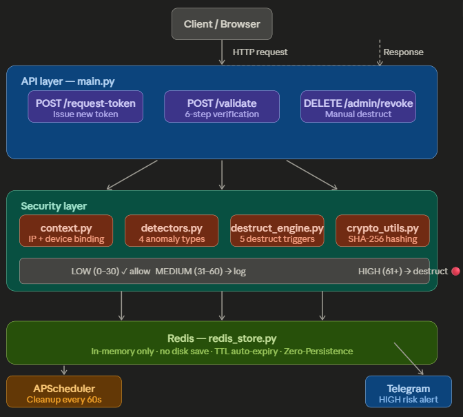

# 🛡️ Zero-Persistence Self-Destructing Token System

> API tokens that automatically invalidate within seconds of a credential leak


---

## 🔥 What is this?

A cybersecurity system that automatically destroys API tokens within seconds of a credential leak. Tokens are never written to disk and self-destruct under 5 different conditions.



---

## 🚀 Quick Start

**Docker (Recommended)** — starts Redis, API, Prometheus and Grafana

```bash
git clone https://github.com/mBlYaTm/capstone_gerooo2
cd capstone_gerooo2
cp .env.example .env
docker compose up -d --build
```

| Service | URL |
|---|---|
| Live dashboard | http://localhost:8000 |
| API docs (Swagger) | http://localhost:8000/docs |
| Grafana (`admin` / `admin`) | http://localhost:3000 |
| Prometheus | http://localhost:9090 |

**Tests** (Redis must be running)

```bash
python3.11 -m venv venv
source venv/bin/activate          # Windows: venv\Scripts\activate
pip install -r requirements.txt
pytest test_system.py -v --cov=. --cov-report=html
```

📘 Step-by-step setup guide for Mac (Mongolian): [START_HERE_MAC.md](START_HERE_MAC.md)

---

## ✨ Features

| Feature | Description |
|---|---|
| 🔒 Zero-Persistence | Tokens never saved to disk (Redis with persistence disabled) |
| 🔗 Context Binding | Tokens locked to IP + User-Agent |
| 🚨 4 Anomaly Detectors | Real-time attack detection with risk scoring |
| 💥 5 Auto-Destruct Triggers | Automatic token deletion |
| ⚛️ Atomic Use Counting | Redis Lua script — `max_uses` holds under concurrent requests |
| 📱 Telegram Alerts | HIGH risk and replay notifications (throttled, non-blocking) |
| 📊 Live Dashboard + Grafana | Real-time event feed, Prometheus metrics |
| 🛡️ Security Headers | CSP, X-Frame-Options, HSTS, Rate Limiting |

---

## ✅ 6-Step Validation Pipeline

1. **JWT signature** check (HS256)
2. **Redis existence** check — a destroyed token coming back is flagged as a **replay attack**
3. **Context** check — IP + User-Agent must match
4. **Risk score** check — velocity, geo, endpoint enumeration
5. **Use counter** — atomic check-and-increment against `max_uses`
6. **Final use** — token is destroyed immediately after its last allowed use

---

## 🔐 4 Anomaly Detectors

| Detector | Trigger | Score |
|---|---|---|
| Replay Attack | A destroyed token is presented again | +30 (always rejected + alert) |
| Velocity Burst | 10+ requests per second from one IP | +40 |
| Geo Impossible | Physically impossible travel (needs GeoLite2 DB) | +50 |
| Endpoint Enum | 5+ different 404 paths from one IP in 1 hour | +35 |

- **LOW (0–30)** → Allow
- **MEDIUM (31–60)** → Allow and log
- **HIGH (61+)** → Destroy token + Telegram alert

---

## 💥 5 Auto-Destruct Triggers

| # | Trigger | Condition |
|---|---|---|
| 1 | TTL Expiry | Redis auto-delete after 300s |
| 2 | Context Drift | IP address or User-Agent changed |
| 3 | Max Uses | Usage limit reached |
| 4 | High Risk | Anomaly score ≥ 61 |
| 5 | Admin Revoke | Manual deletion via API |

Every destruction is written to `destruct_events.log`.

---

## 📊 Test Results

- ✅ 53/53 tests passed — coverage 77%
- ✅ OWASP ZAP: 0 critical vulnerabilities — [reports/zap/index.html](reports/zap/index.html)
- 📈 Load test results — [reports/load_test_report.json](reports/load_test_report.json)

---

## 📁 Project Structure

```
├── main.py               FastAPI app, SSE, security headers, rate limiting, 404 tracking
├── token_engine.py       Token creation + 6-step validation
├── redis_store.py        Redis operations (atomic use counter)
├── context.py            IP + User-Agent binding
├── detectors.py          4 anomaly detectors + RiskScorer
├── destruct_engine.py    5 auto-destruct triggers + event log
├── alerting.py           Telegram alerts
├── crypto_utils.py       SHA-256 hashing
├── dashboard.html        Live dashboard
├── test_system.py        53 tests
├── load_test.py          Load test script
├── locustfile.py         Locust load test (1000 users)
├── monitoring/           Prometheus + Grafana configuration and dashboard
├── reports/              OWASP ZAP scan and load test results
├── Dockerfile
└── docker-compose.yml
```

---

## 🔧 Tech Stack

| Technology | Purpose |
|---|---|
| FastAPI | REST API + SSE |
| Redis | Zero-persistence storage |
| Docker Compose | Containerization |
| Prometheus + Grafana | Monitoring |
| JWT HS256 | Token signing |
| SHA-256 | Token hashing |
| APScheduler | Background cleanup |
| Telegram Bot | Real-time alerts |
| pytest + Locust | Testing and load testing |
